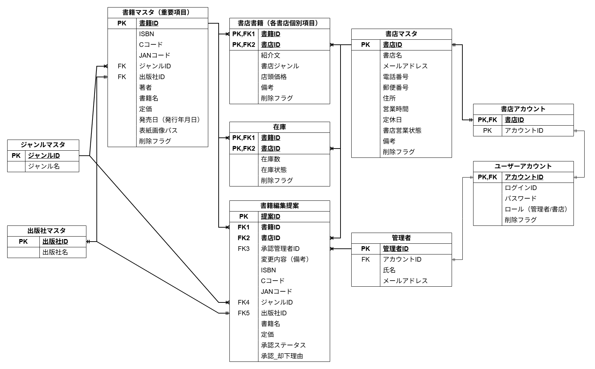

## 概要
### システム名 
　 書籍情報統合システム 

### 開発背景 
近年、電子書籍やネット通販の普及により、実店舗で書籍を購入する機会が減少している。また、書籍を探す際には複数の書店を回ったり、各書店が提供する検索サービスを個別に利用したりする必要があり、利用者の負担となっている。

### システム概要 
　本システムは、複数書店が保有する書籍情報および在庫情報を一元管理し、利用者が単一のアプリケーションから効率的に検索できることを目的とした書籍情報統合システムである。
　大学時代にチーム開発で作成したシステムをベースとし、リバースエンジニアリングを実施した上で、Spring Boot・MyBatis・MySQLを用いて再設計・再構築を行った。

## 使用技術

| カテゴリ       | 技術スタック                                      |
| -------------- | ------------------------------------------------- |
| フロントエンド | HTML（Thymeleaf）, CSS(bootstrap含む), JavaScript |
| バックエンド   | Java 21（SpringBoot 4.0.5）                       |
| O/Rマッパー    | MyBatis 4.0.1                                     |
| データベース   | MySQL 8.4.8                                       |
| ビルドツール   | Maven                                             |
| IDE            | Eclipse 2025-06                                   |
| etc.           | jBcrypt 0.4.3, Fork 2.20.1.0                                     |

## 機能一覧（主な機能とこだわりポイント）

| 機能名         | ロール        |
| -------------- | ------------- |
| 書籍管理       | 管理者/書店員 |
| 書店管理       | 〃            |
| 在庫管理       | 書店員のみ    |
| 認証           | 管理者/書店員 |
| ダッシュボード | 〃            |
| 検索           | 購買者        |

## 工夫した点
   1. 在庫管理機能 
　在庫情報を単純に一覧表示するのではなく、書店単位でまとめて表示できるようデータ整形処理を実装した。利用者が店舗ごとの在庫状況を把握しやすい画面構成を意識した。

   1. 書籍編集機能 
　書籍マスタ情報と書店個別情報（書店毎の価格や紹介文など）を同一画面で扱う構成となっていたため、既存の編集可否制御（チェックボックス）を活用し、書店個別情報の更新・新規登録を切り替える仕組みを実装した。

   1. GitHub Issuesによるタスク管理 
　開発中に発生した不具合や改善事項をIssueとして管理し、原因調査から修正までの履歴を残しながら開発を進めた。関連する不具合についてはIssueを統合し、効率的な管理を行った。

   1. 設計書作成の進め方 
　設計書を最初から完璧に作り込むのではなく、画面構成や機能概要を先に整理し、詳細設計を後から補完する形で作業を進めた。スケジュールを意識しながら設計と実装を並行して進められるよう工夫した。 

## 苦労した点 
   1. 書籍編集提案機能の設計
　承認・却下を伴うワークフローやデータの受け渡し方法を検討する必要があり、DTO設計や業務フロー設計に苦労した。最終的に実装は見送ったが、設計を通じて複雑な業務フローを整理する経験を得ることができた。

   1. 書籍編集機能 
　書籍マスタ情報と書店個別情報を同一画面で扱う構成であったため、更新対象の切り分けが難しかった。特に、書店個別情報については更新と新規登録の両方に対応する必要があり、処理設計に苦労した。

   1. 在庫管理機能 
　在庫単位ではなく書店単位で表示・ページネーションを行う必要があり、取得データの整形処理が複雑になった。表示要件を満たすためにデータ構造や処理方法を何度も見直した。

   1. SQL不具合の調査 
　在庫登録画面で発生した複数の不具合について調査を行ったところ、データ汚染とSQL条件設定の不備が複合的に影響していた。原因の切り分けに時間を要したが、データを整理しながら一つずつ検証することで解決した。

## E-R図
　

## アプリのURL, 動作環境
### URL
管理者・書店員用：https://ibis.mydns.jp/auth/login 
購買者用：https://ibis.mydns.jp/search
### 動作環境
ブラウザ：GoogleChrome / 画面サイズ 横幅1440px以上 推奨

## 今後の課題と展望

### 課題

* 見送りとした機能（書籍編集提案機能、ISBN重複時の登録処理等）の実装
* エラーハンドリングの強化
* 設計と実装の乖離を抑制する開発プロセスの改善
* リファクタリングによる保守性向上
* 単体・結合・総合テストの実施
* 異常系・例外ケースを考慮した設計の強化

### 展望

* Spring Securityを導入した認証・認可機能の強化
* JUnitを用いたテストコード作成
* 書店管理者による書店員アカウント管理機能の実装
* SQL最適化およびインデックス設計の学習・適用
* 継続的な機能改善によるシステム品質向上

本プロジェクトでは、リバースエンジニアリングから設計、実装、
不具合調査までの工程を経験した。
今後はSpring Securityやテストコード作成などにも取り組み、
より実運用を意識したシステム開発ができるエンジニアを目指したい。
